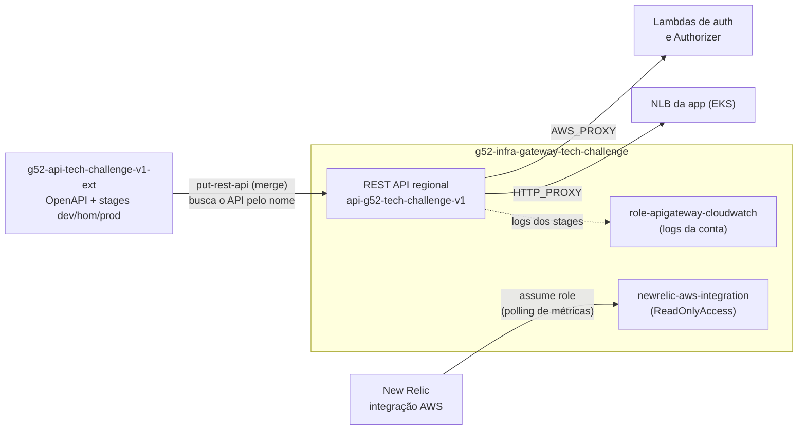

# g52-infra-gateway-tech-challenge

Terraform do **API Gateway** do Tech Challenge (Grupo 52). Ele cria o REST API `api-g52-tech-challenge-v1`, a porta de entrada única da solução, e as configurações que valem para a conta inteira: a role de logs do API Gateway e a role da integração AWS do New Relic.

As rotas, as integrações e os stages (`dev`, `hom` e `prod`) não ficam aqui. Eles vêm do contrato OpenAPI, no [`g52-api-tech-challenge-v1-ext`](https://github.com/Teplotax/g52-api-tech-challenge-v1-ext), que é importado neste REST API.

## Links

| | |
|---|---|
| Documentação da API (Swagger) | https://teplotax.github.io/doc-api-tech-challenge-v1/ |
| Collection Postman/Insomnia | Enviada no PDF de entrega, porque contém CPFs de teste do seed |
| Arquitetura da solução (diagramas, RFCs, ADRs) | [`g52-app-tech-challenge/docs/arquitetura`](https://github.com/Teplotax/g52-app-tech-challenge/tree/main/docs/arquitetura) |
| Pipelines | [GitHub Actions](https://github.com/Teplotax/g52-infra-gateway-tech-challenge/actions) |

### Deploys

Todos os ambientes respondem por este REST API, com um stage por ambiente:

| Ambiente | URL base | Healthcheck |
|---|---|---|
| dev | https://08onkvn4jb.execute-api.us-east-1.amazonaws.com/dev | [`/dev/health`](https://08onkvn4jb.execute-api.us-east-1.amazonaws.com/dev/health) |
| hom | https://08onkvn4jb.execute-api.us-east-1.amazonaws.com/hom | [`/hom/health`](https://08onkvn4jb.execute-api.us-east-1.amazonaws.com/hom/health) |
| prod | https://08onkvn4jb.execute-api.us-east-1.amazonaws.com/prod | [`/prod/health`](https://08onkvn4jb.execute-api.us-east-1.amazonaws.com/prod/health) |

Para economizar, os ambientes ficam desligados quando não estão em uso ([ADR-003](https://github.com/Teplotax/g52-app-tech-challenge/blob/main/docs/arquitetura/adrs/ADR-003-ambientes.md)). O healthcheck mostra se um ambiente está no ar. O REST API em si não custa nada parado, então nunca é destruído.

## Arquitetura



| Recurso | Descrição |
|---|---|
| `aws_api_gateway_rest_api.this` | REST API regional. Os outros repositórios o encontram pelo nome (`api_name`), não pelo ID |
| `aws_iam_role.apigw_cloudwatch` + `aws_api_gateway_account.this` | Role de logs do API Gateway. É uma configuração da conta, então vale para os três stages |
| `aws_iam_role.newrelic_integration` | Role `newrelic-aws-integration` (somente leitura, com `ExternalId` = conta do New Relic), usada para coletar métricas de Lambda, API Gateway e RDS. Criada só se `newrelic_account_id` estiver preenchido |
| `aws_api_gateway_api_key` / `aws_api_gateway_usage_plan` | API Key e usage plan com throttling e quota. Só se `require_api_key = true` (desligado) |

## Tecnologias

Terraform (provider `aws`), Amazon API Gateway (REST), IAM, CloudWatch Logs e GitHub Actions com OIDC.

## Estrutura

```
infra/
├── main.tf                  # REST API, role de logs, role do New Relic, API Key/usage plan opcionais
├── variables.tf / locals.tf / providers.tf
├── outpouts.tf              # api_gateway_id, api_key, newrelic_integration_role_arn
└── inventories/dev/terraform.tfvars
```

## Execução manual

Pré-requisitos: Terraform >= 1.6 e AWS CLI autenticado na conta.

```bash
cd infra
terraform init -reconfigure \
  -backend-config="bucket=g52-terraform-state-dev-<account-id>" \
  -backend-config="key=dev/api-g52-tech-challenge-v1/terraform.tfstate" \
  -backend-config="region=us-east-1"

terraform plan  -var-file=inventories/dev/terraform.tfvars
terraform apply -var-file=inventories/dev/terraform.tfvars
```

Para descobrir o ID do REST API:

```bash
aws apigateway get-rest-apis --query "items[?name=='api-g52-tech-challenge-v1'].id" --output text
```

### Variáveis principais

| Variável | Descrição |
|---|---|
| `api_name` | Nome do REST API (`api-g52-tech-challenge-v1`). Também compõe a key do state |
| `environment` | Ambiente do state (`dev`). O REST API é compartilhado pelos três stages |
| `newrelic_account_id` | Conta do New Relic. Vazio não cria a role da integração |
| `require_api_key`, `throttle_burst_limit`, `throttle_rate_limit`, `quota_limit` | API Key e usage plan (opcionais) |
| `log_retention_days` | Retenção dos logs |
| `destroy` | `true` faz o pipeline executar `terraform destroy` |

## Deploy (CI/CD)

```
feature/** -> develop -> release/vX.X.X -> main
```

| Workflow | Gatilho | Ação |
|---|---|---|
| `1 - [FEAT] Build & PR` | Push em `feature/**` | Abre PR automático para `develop` |
| `2 - [DEV] Build and Deploy` | Merge em `develop` | `terraform apply` (ou `destroy`); cria a branch e o PR `release/vX.X.X` |
| `3 - [HOM] Promote & Deploy` | Merge do PR em `release/**` | Abre o PR da release para `main` |

Este repositório tem um único deploy, porque o REST API é compartilhado pelos ambientes. O que muda por ambiente é o stage, criado pelo contrato. Os workflows não rodam na abertura de PR, só no merge. A autenticação na AWS é via **OIDC** (role `github-actions-terraform-dev`), e a branch `main` é protegida: o merge só acontece por Pull Request.

**Ordem:** este é o primeiro repositório a subir. O contrato precisa do REST API para importar as rotas.

## Repositórios do projeto

| Repositório | Conteúdo |
|---|---|
| [g52-app-tech-challenge](https://github.com/Teplotax/g52-app-tech-challenge) | Aplicação Spring Boot, manifestos Kubernetes e documentação de arquitetura |
| [g52-lambda-tech-challenge](https://github.com/Teplotax/g52-lambda-tech-challenge) | Function Serverless de autenticação (CPF e `client_credentials`) e Lambda Authorizer |
| [g52-infra-eks-tech-challenge](https://github.com/Teplotax/g52-infra-eks-tech-challenge) | Cluster EKS, ECR, add-ons e observabilidade (New Relic) |
| [g52-infra-rds-tech-challenge](https://github.com/Teplotax/g52-infra-rds-tech-challenge) | Banco gerenciado (RDS PostgreSQL) e modelo de dados |
| **g52-infra-gateway-tech-challenge** (este) | REST API do API Gateway e roles da conta |
| [g52-api-tech-challenge-v1-ext](https://github.com/Teplotax/g52-api-tech-challenge-v1-ext) | Contrato OpenAPI importado no API Gateway (stages dev/hom/prod) |
| [doc-api-tech-challenge-v1](https://github.com/Teplotax/doc-api-tech-challenge-v1) | Swagger publicado no GitHub Pages |
